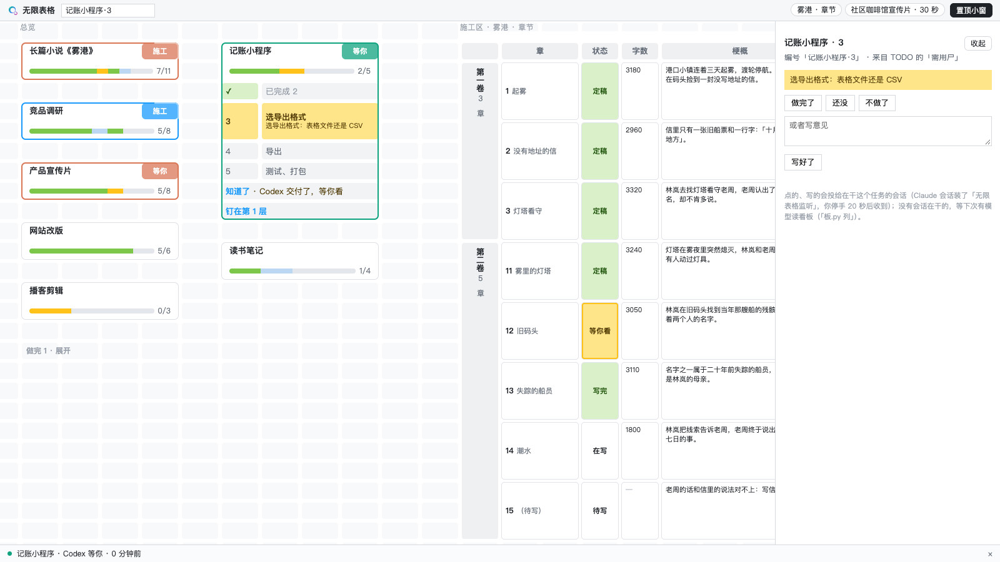
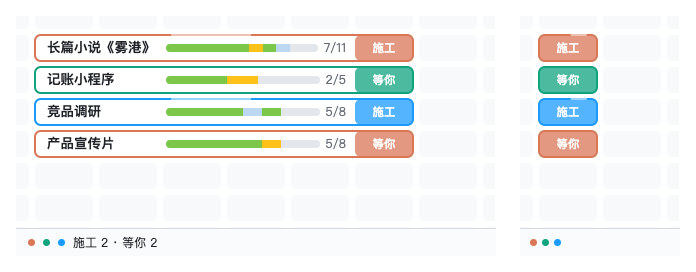
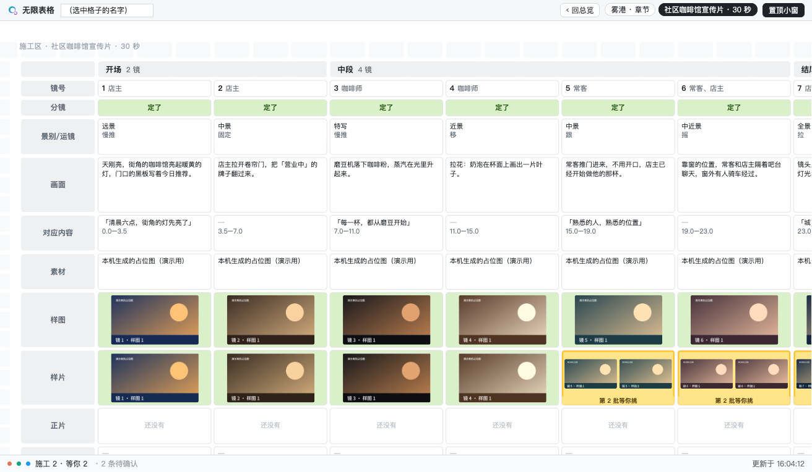

<picture>
  <source media="(prefers-color-scheme: dark)" srcset="docs/logo/qlimen-tabula-lockup-dark.svg">
  
</picture>

# Qlimen Tabula · 无限表格

一张格子表，看所有 AI 长任务的进度、谁在干、哪件在等你拍板。

同时开着好几个 AI 会话做长任务，每个任务一份 `TODO.md`：想知道「到哪了、谁在干、哪件等我」，就得一个个翻会话、开文件。无限表格把它们摆在一张表上：抬眼就看到进度，点一下就地展开 TODO，要你拍板的事是黄的，点一下就能答。

- **只读你已有的东西**：进度从各任务的 `TODO.md` 读，谁在干由干活的 AI 开灯关灯（Claude 有插件代劳，Codex 由看板读她的记录代劳，别家敲一条命令）。看板不改你的 TODO。
- **很轻**：一个只用系统自带 Python 的本机服务加一个网页，只听 127.0.0.1，不装第三方包、不联网、不要账号。
- **配 [Qlimen](https://github.com/NPCONTEXT/Qlimen) 用最顺**：状态词、TODO 写法都来自 Qlimen 的核心协议；不用 Qlimen 也能用。



<sub>演示数据。左边是总览：一个任务一块，选框的颜色是谁在负责（橙 Claude、绿 Codex、蓝 K31），名牌写状态；「记账小程序」点开了，第 3 步是黄的、在等你。中间是小说的施工区。右边是点开那一步后的右栏：做完了 / 还没 / 不做了，或者写意见。</sub>

名字：Tabula 是拉丁语的「板、写字板、表」，和 Qlimen 的 Limen 一样是拉丁语；中文名叫「无限表格」。

## 四张图看懂


<sub>四张图由 GPT-image-2 生成，人设和 Qlimen 的科普图是同一套。</sub>

---

## 30 秒看懂

1. **一张表、三个镜头**：第 1 层是进度条（只放在干的、等你的、还有活的），第 2 层是总览（所有任务，一个任务一块），第 3 层是施工区（重活的工作台）。三层是同一张格子表，一个窗口里原地变形；左上角 x − + 就是全部按钮。再缩一层是只剩名牌的一列，适合放在屏幕角上。
2. **颜色是谁，亮片是在跑，名牌是状态**：选框的颜色只表示谁在负责；选框上走着一段亮片就是正在跑；名牌只写「施工 / 等你 / 收工 / 待续」。
3. **你只做两件事：点头、写意见**：TODO 里要你拍板的步骤是黄的，点开写「做完了 / 还没 / 不做了」或写意见。装了 Claude 插件的会话，你停手 20 秒后就收到。
4. **施工区**：一部小说的每一章、一支片子的每一个镜头都是一格。你直接在格子里改字、挑样图样片、点通过；改完点「叫醒 Claude」，它读到你改了哪几格接着干；忘了点，10 分钟后左下角亮个红点提醒，不会自己推过去。

<table>
<tr>
<td width="44%"></td>
<td></td>
</tr>
<tr>
<td><sub>原生置顶小窗的第 1 层（左）和名牌层（右）</sub></td>
<td><sub>分镜施工区：一镜一列，样图、样片两行放候选，黄的是「第 2 批等你挑」</sub></td>
</tr>
</table>

## 快速开始

要 macOS 和 Xcode 命令行工具（`git`、`/usr/bin/python3` 都靠它；新 Mac 第一次运行时会弹框让你装，也可以先跑 `xcode-select --install`）。

```bash
git clone https://github.com/NPCONTEXT/Qlimen-Tabula.git ~/Documents/Qlimen-Tabula
```

1. 双击仓库里的 `打开无限表格.command`，浏览器会打开 http://127.0.0.1:8770/ 。第一次打开会先准备演示：8 个演示任务、小说和分镜两个施工区、三盏演示灯。
2. 换成你自己的任务：把 `设置.example.json` 复制成 `设置.json`，`工作区` 改成放你任务的文件夹（看板会扫它下面所有带 `TODO.md` 的目录），再跑 `/usr/bin/python3 ~/Documents/Qlimen-Tabula/工具/板.py 设置` 核对；然后关掉看板的终端窗口，再双击一次。
3. 接上你的 AI：
   - **Claude 桌面应用**：`bash ~/Documents/Qlimen-Tabula/工具/装插件.sh` 先预演，加 `--装` 真装；新开的会话自动开关灯，你在看板上点的、写的会发进会话。
   - **Codex（ChatGPT 桌面应用）**：`设置.json` 里写 `"Codex": {"开": true}`，看板读她的会话记录替她开关灯；给她读一遍 [接入/codex-指南.md](接入/codex-指南.md)。
   - **别的 AI**：让它每段开头敲 `板.py 开工 任务`、交付敲 `板.py 等你 任务`、做完敲 `板.py 收工 任务`。

详细的看法、操作、TODO 写法、施工区、原生小窗、设置项、命令，都在 [使用说明](docs/使用说明.md)。为什么这么设计见 [设计理念](docs/设计理念.md)。

## 和 Qlimen 的关系

[Qlimen](https://github.com/NPCONTEXT/Qlimen) 管 AI 怎么守规矩干活：先调研、写方案、等批准；进度落在 `TODO.md`；每条回复开头写状态词【施工】【等你】【收工】。无限表格不新造规矩，只把这些状态摆出来：

| Qlimen 里的 | 在无限表格上 |
|---|---|
| 任务目录里的 `TODO.md` | 总览里的一块：进度条、点开就地展开的步骤 |
| `[需用户]` 的步骤 | 黄格子：点开右栏答「做完了 / 还没 / 不做了」或写意见 |
| 回复开头的状态词 | 名牌：施工 / 等你 / 收工 |
| 派工脚本 waibao 的账本 | 工人在跑，自动亮蓝灯（设置里填 `派工账本`） |

不用 Qlimen 的话，让你的 AI 照[使用说明里的 TODO 写法](docs/使用说明.md#todo-怎么写看板才读得准)写 TODO、回复开头写状态词，效果一样；写法差太远的，看板写「读不出」，不猜。

## 已知限制

- **只在作者一台 Mac（macOS 26）上用过**。Windows、Linux 没适配：用到了 `/usr/bin/open`、`lsof`、Swift 写的小窗、`claude://` 和 `codex://` 链接。
- **Claude 那半靠 Claude 桌面应用的插件（模组）机制，Codex 那半靠读她本地的会话记录格式**。两样都不是公开承诺的稳定接口，应用一更新可能失效。
- **只在本机**：服务只听 127.0.0.1，没有账号、多人、手机。
- **读 TODO 是按规则读的**：照使用说明的写法读得准，写法差太远会「读不出」；灯准不准，也要看 AI 有没有照写状态词。
- **批量改过的 TODO 会暂时算休眠**：看板把「同一两分钟里一起改过的一批 TODO」当成批量整理、不算动静。clone、同步之后会这样；演示工作区跑一次 `板.py 演示`，自己的任务动一下就回来。
- **施工区引擎只在作者的两类活上实际用过**（MV 分镜、小说）。字段、排法靠 `区域.json` 配，差得多的活可能要改引擎。
- **原生小窗要自己编译**：要 Xcode 命令行工具，本机签名、没公证；每次重编后第一次读「文稿」要点授权。
- **仓库要放在不带空格的路径里**（插件要认出命令里的路径）。
- **全是中文**：界面、文档、命令，连代码里的变量名都是中文。代码注释里的「卷四 6.67」这类编号和日期是作者开发时内部文档的，那些文档没放进仓库。
- 看板上「接手」开新会话时，第一句话是直接发出还是只填进输入框，Claude、Codex 都没实测。

## 测试

```bash
/usr/bin/python3 ~/Documents/Qlimen-Tabula/工具/跑全部测试.py
```

读 TODO 的标准答案（演示工作区 8 份）、11 个 python 测试、4 个页面测试（无头 Chrome，要 node 和 Google Chrome）、Claude 插件测试（要 Claude Code 自带的 `claude` 命令）。全用临时目录，不花钱、不联网、不碰你的数据。2026-11-09 在作者的 Mac 上：14 组全过（python 182 条、页面 92 条、插件 80 条）。

## 目录

```
打开无限表格.command    双击启动（第一次会准备演示）
设置.example.json       复制成 设置.json 再改
工具/板.py              看板服务和命令
工具/板-页面.txt         网页（用 .txt，免得编辑器、AI 工具把它当网页自动打开）
工具/施工台.py           施工区引擎
工具/施工区模板/         小说、分镜两个模板
工具/小窗/              原生置顶小窗（Swift），工具/编译小窗.sh 编译
工具/装插件.sh           装 Claude 桌面应用的插件
工具/跑全部测试.py       一条命令跑全部测试；测*.py、测*.js 是各个测试
接入/                   各家怎么打开会话、开新会话；给 Codex 的指南
插件/ban-listen/        Claude 桌面应用的插件「无限表格监听」
示例/演示工作区/         8 个演示任务、2 个演示施工区
docs/                   使用说明、设计理念、截图、漫画、标志
```

## 许可证

MIT，见 [LICENSE](LICENSE)。标志（`docs/logo/` 里的图形和字标）不随 MIT 授权，介绍本项目时可以用。标志的字体是 Outfit 和思源黑体（都是 SIL OFL 1.1），SVG 里的字已转成曲线。演示数据里的样图、样片是本机代码生成的占位图；四张漫画由 GPT-image-2 生成。

更新记录见 [更新日志](更新日志.md)。
